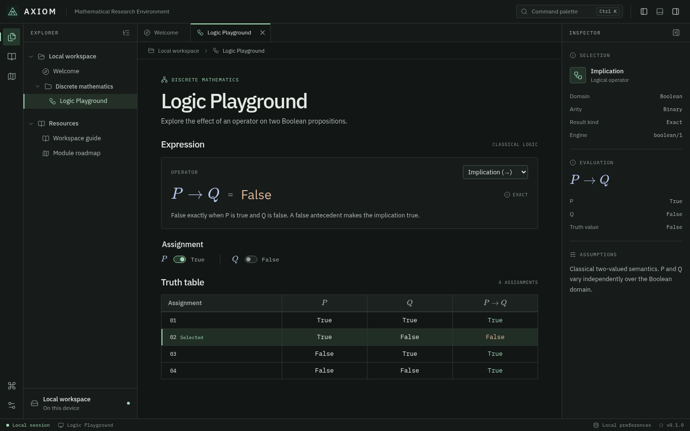

# AXIOM — Mathematical Research Environment

_Explore. Reason. Discover._

AXIOM is an open-source, local-first desktop workspace for mathematical exploration. It gives students and researchers a place to change an assumption, inspect an exact result, and connect a computational experiment to its mathematical definition.



## Current capabilities

Phase 01 ships a working Linux desktop application and a standalone browser preview. Logic Playground evaluates conjunction, inclusive disjunction, negation, material implication, and biconditional over two Boolean propositions. Every expression has a complete truth table, an inspectable domain and a versioned exact result.

The workspace includes tabs, an explorer, a contextual inspector, keyboard commands, resizable panels and a session log. Preferences live on the device. The desktop runs offline after installation, including notation and fonts.

## Run from source

Install Git, Node.js 24 or newer, pnpm 11.25.0, stable Rust with Cargo, and the Linux Tauri development libraries. On Arch, the native build needs the base development tools, GTK 3, WebKitGTK 4.1, librsvg and OpenSSL development files. See the platform-specific prerequisite list before installing missing packages. [Tauri prerequisites](https://v2.tauri.app/start/prerequisites/)

```sh
git clone https://github.com/NumenDev/axiom.git
cd axiom
pnpm install --frozen-lockfile
pnpm desktop dev
```

For a release executable, run `pnpm desktop build --no-bundle -- --locked` and launch `./src-tauri/target/release/axiom` on Linux. This phase distributes source. The first dependency fetch requires network access.

For interface development alone, run `pnpm dev` and open the loopback address printed by Vite. The browser preview keeps its own layout preferences. Run `pnpm test` for domain and interface tests and `pnpm build` for type checking and the production frontend. The development guide covers native checks, Playwright and offline rebuilds. [Development guide](docs/development/README.md)

## Architecture

React presents the workspace. Application services connect the static module registry and preference store. The pure TypeScript Boolean engine accepts typed propositions and produces exact results without I/O. Tauri exposes two typed preference commands to its local main window. Rust owns SQLite, migration transactions and input validation. [Architecture](docs/architecture/README.md) · [Decisions](docs/decisions/README.md)

## Direction and status

The long-term direction brings symbolic computation, notebooks, visualization, reproducible experiments and formal proof into one research environment. The next proposed phase defines a versioned expression representation and deterministic evaluation. Phase 01 evidence and remaining verification are recorded in the engineering report. [Roadmap](docs/ROADMAP.md) · [Phase 01 report](docs/reports/PHASE_01_REPORT.md)

## Contributing and license

Contributions should include executable correctness evidence and preserve offline operation. AXIOM is released under the MIT license. Third-party code and local fonts retain their respective licenses. [Contributing](CONTRIBUTING.md) · [MIT license](LICENSE) · [Bundled notices](public/licenses)
