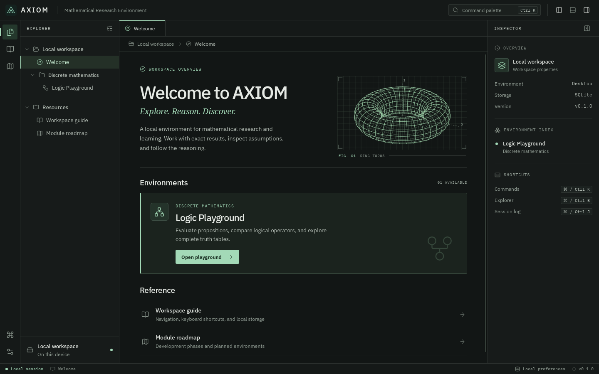
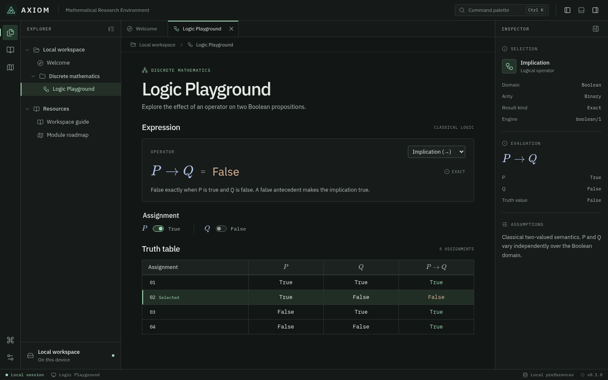

# Phase 01 engineering report

**AXIOM 0.1.0 · 24 November 2026 · Arch Linux x86-64**

## Delivery

Phase 01 supplies a runnable Tauri desktop workspace and an exact Boolean environment. A user can select a connective, change either proposition, inspect the result, and locate the assignment in its complete truth table. The application runs from bundled assets and persists layout preferences on the same device.

## Architecture and repository

Six accepted decisions cover the desktop stack, engine ownership, SQLite persistence, result evidence, a static module registry, and future process isolation. The bounded Boolean engine runs in TypeScript. Rust owns the native integration and database. There is one frontend package and one native crate. [Decision records](../decisions/README.md) · [Architecture](../architecture/README.md)

| Location            | Responsibility                                                             |
| ------------------- | -------------------------------------------------------------------------- |
| `src/domain`        | Deterministic evaluation, checked input errors and table enumeration       |
| `src/application`   | Module metadata, preference contracts and storage adapters                 |
| `src/presentation`  | Workspace commands, focus, views, mathematical notation and figures        |
| `src-tauri`         | Native host, command allowlist, transactional migration and SQLite tests   |
| `tests`             | Independent Boolean oracle, interface, persistence and real-browser checks |
| `public`            | Local identity assets and third-party notices                              |
| `.github/workflows` | Read-only frontend and native CI jobs                                      |
| `docs`              | Decisions, development, design, mathematics, roadmap and phase evidence    |

## Workspace and mathematics

The shell includes dockable explorer and inspector panels, a tabbed document area, session log, command search and status bar. Keyboard shortcuts work alongside ordinary buttons, tab navigation, switch controls and pointer or keyboard resizing. Preferences cover panel visibility, sizes and density. Startup recovers from a missing or malformed settings document and protects incompatible versions.

The `boolean/1` engine takes an operator ID and two Boolean operands. Its result carries an exactness tag and an engine identifier. Table order is TT, TF, FT, FF. Negation applies to P while Q remains independently selectable. Implication is false only for TF. Biconditional is true for TT and FF. Every operator has an independently transcribed four-row oracle. The inspector exposes the selected rule, assumptions, result kind and current values. [Correctness guidelines and truth table](../mathematics/README.md)

## Design and visual evidence

The shell uses graphite surfaces, local Plex fonts, mint selection accents and blue mathematical notation. False and true results include explicit text. Against the panel surface, the primary, secondary and muted text tokens measured 14.16:1, 9.01:1 and 6.32:1 respectively. These are individual color-pair measurements. Keyboard interaction and layout were also exercised in the rendered application.

Playwright captured the actual welcome and logic views at 1920 × 1080, 1440 × 900, 1024 × 768 and 720 × 540. The 1440 px welcome capture below comes from the compiled desktop application on a private X11 display. The implication capture comes from the browser preview. After visual inspection, the welcome plate was shortened, the surface mesh gained front/back differentiation, and inspector values gained a larger type size. At small sizes the document scrolls and panels open on demand.

[Design system](../design/README.md)

## Dependencies

React and Vite serve and bundle the interface. TypeScript verifies its contracts. Tauri 2 uses the system webview. Serde validates command payloads. The rusqlite adapter uses bundled SQLite for consistent storage behavior. KaTeX supplies local HTML and MathML notation. Lucide provides a consistent icon set, and Fontsource supplies the OFL-licensed Plex faces. Package versions and integrity records live in the pnpm and Cargo lockfiles.

Vitest and Testing Library cover domain and UI behavior. Playwright drives a real browser. Rust tests exercise SQLite. Formatting and linting use Prettier, ESLint, rustfmt and Clippy. Python engines, Lean, D3, Plotly, Three.js and AI runtimes remain future integration decisions.

## Executed checks

Local toolchain included Node 26.13.1, pnpm 11.25.0, Rust 1.98.0, GTK 3.24.52 and WebKitGTK 2.54.3. The final installed production dependency audit returned zero known advisories after updating KaTeX. The table records executed local checks.

| Command or exercise                                                                                 | Result                                                                                                                                                    |
| --------------------------------------------------------------------------------------------------- | --------------------------------------------------------------------------------------------------------------------------------------------------------- |
| `pnpm install --offline --frozen-lockfile`                                                          | Passed with populated package store                                                                                                                       |
| `pnpm typecheck`, `pnpm lint`, `pnpm format:check`                                                  | Passed                                                                                                                                                    |
| `pnpm test`                                                                                         | 32 tests passed, including all 20 connective/assignment pairs, table enumeration, malformed input, preference recovery and UI behavior                    |
| `pnpm test:e2e` with `AXIOM_CHROMIUM` pointing to installed Chrome                                  | 7 passed, including command search from the keyboard, retained layout, reduced-size drawers and viewport checks                                           |
| `cargo fmt --manifest-path src-tauri/Cargo.toml --check`                                            | Passed                                                                                                                                                    |
| `cargo clippy --locked --offline --manifest-path src-tauri/Cargo.toml --all-targets -- -D warnings` | Passed                                                                                                                                                    |
| `cargo test --locked --offline --manifest-path src-tauri/Cargo.toml`                                | 4 passed, including migration rollback, reopening a saved database and future-version protection                                                          |
| `pnpm build`                                                                                        | Production frontend compiled, including bundled fonts and separate notation chunk                                                                         |
| `pnpm desktop dev --no-watch` on a private display                                                  | Vite and WebKitGTK started, and a keyboard toggle reached the isolated SQLite database                                                                    |
| `pnpm desktop build --debug --no-bundle -- --locked --offline`                                      | Native development-profile executable built                                                                                                               |
| `pnpm desktop build --no-bundle -- --locked --offline`                                              | Native optimized executable built                                                                                                                         |
| Native release smoke, temporary XDG profile                                                         | Two launches verified the log toggle through real keyboard input, Tauri IPC and durable SQLite state. The native command palette opened Logic Playground. |
| `pnpm peers check`, `pnpm audit --prod`                                                             | No peer mismatches or known production advisories at the time of the check                                                                                |
| Staged path and blob inspection, `git diff --cached --check`                                        | Reviewed file inventory, native capabilities, workflow permissions, lockfiles, credential patterns and personal paths                                     |

The browser and native graphical runs required permission to open loopback sockets or a local display in this development sandbox. The dependency fetch required network access. Native visual verification used Xvfb extracted into the ignored test directory after checking the package against the Arch repository SHA-256. The test display used software rendering. Development did not change system packages.

## Security review

Only the local main window receives the two application preference commands. Rust owns the path and parameterized SQL, checks bounds, rejects unknown command fields and protects newer schemas. The UI accepts a closed connective vocabulary. KaTeX receives application-authored notation with trust disabled. The release CSP limits assets and IPC to local sources. CI has read-only contents access and pins actions to commit digests. Source assets, PNG metadata and staged file contents were reviewed before publication.

## Limitations, technical debt and manual verification

- The native acceptance target was Linux x86-64. Windows, macOS, other Linux compositors, signed installers and upgrade packaging require separate validation.
- Browser keyboard checks and native panel persistence were exercised. The host's AT-SPI bus was unavailable for a screen-reader pass. Assistive-technology interaction and high-DPI/multi-monitor behavior need manual review.
- The browser preview uses origin-local storage. Desktop preferences use SQLite. Concurrent clients use a whole settings document, with the most recent committed layout winning.
- The module registry is static. Workspace pages, assignments and the latest 100 events live for one session. There are no notebook files or general expression inputs in this release.
- Before introducing a second engine, define a versioned interoperable expression and result schema. Before distributing installers, automate native interaction and dependency notice aggregation across supported platforms.

## Git and publication

Implementation commit `73841ba` introduces the desktop application, logic engine, tests, decisions and CI. The documentation commit titled **Document Phase 01 architecture, verification and roadmap** adds the project guide, screenshots and this report. The public repository uses the `main` branch. [NumenDev/axiom](https://github.com/NumenDev/axiom) · [Implementation commit](https://github.com/NumenDev/axiom/commit/73841ba7194cd03ae59a1f68d88b10611a8b74a6) · [Hosted verification](https://github.com/NumenDev/axiom/actions/workflows/verify.yml)

## Proposed Phase 02 acceptance

The next authorized phase would define mathematical expression representation, parsing and deterministic evaluation.

1. Specify a versioned, serializable syntax tree, supported grammar, operator precedence and source spans. Test round trips, malformed input and incompatible versions.
2. Define domains and bindings explicitly. Preserve exact integer and rational values across serialization. Describe any approximation with an explicit precision contract.
3. Evaluate a bounded grammar through a deterministic engine. Return structured domain, syntax and resource-limit errors. Cover deeply nested, oversized and invalid inputs.
4. Provide independently verified examples, including precedence, signs and division by zero. Record assumptions and engine version with every result.
5. Exercise the contract through one accessible workspace flow. Retain Phase 01 regression coverage and update the architecture, threat boundaries and phase report.

[Fourteen-phase roadmap](../ROADMAP.md)
