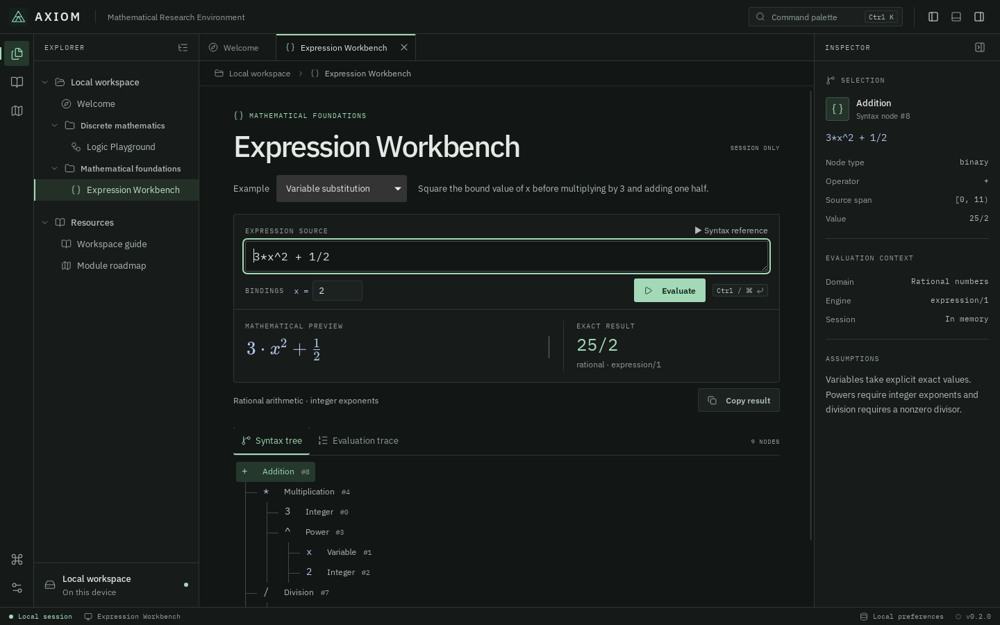

# Phase 02 engineering report

**AXIOM 0.2.0 review candidate · 25 November 2026 · Arch Linux x86-64**

## Delivery and baseline

**Implemented.** Expression Workbench turns mathematical source into a versioned syntax tree, a rendered expression, exact rational values and an inspectable sequence of operations. Students can change a binding and see where it enters the calculation. The Boolean workspace and storage contracts remain compatible.

**Verified baseline.** The working tree was clean on main. Both the local revision and remote main resolved to `b2bedf49c76e2e16162c8db254fabace5d0bc875`. The existing suite passed before changes: 32 Vitest, 7 Playwright and 4 native tests. The development branch is `feat/phase-02-expression-engine`. The MIT license and both original hosted CI jobs are retained.

## Language, parser and values

ASCII identifiers, integers, finite decimals, parentheses and five binary operators form the input language. Recursive descent implements left folds for sums and products and signed right operands for powers. A group has its own node. For example, `-2^2` evaluates to −4, `(-2)^2` to 4 and `2^-3` to 1/8. Input must be consumed completely. The lexer preserves exact lexemes and half-open UTF-16 spans.

The evaluator keeps a pair of BigInts in lowest terms, with a positive denominator. Decimal digits are scaled by an exact power of ten. Multiplication cancels cross factors. Integer powers use repeated squaring, including reciprocals for negative powers. Division by zero, noninteger exponents and 0^0 have distinct diagnostics. All nine educational examples are available in the example selector. [Grammar, examples and arithmetic conventions](../mathematics/expressions.md)

## AST, evaluation and interoperability

The flat `axiom.expression/1` node table uses array indices as document-local IDs. Source and syntactic identity survive serialization. Numeric canonicalization preserves the exact value of distinct spellings such as `00.50` and `0.5`. Deserialization limits the wire envelope, rejects duplicate fields and checks integer offset spelling before the host JSON parser can round it. Import and export verify the full table against a new parse of the source. This prevents divergence between displayed text and executable mathematics.

Bindings are unique explicit names mapped to exact values. An unbound identifier leaves the parsed tree available. Evaluation traverses children before parents, recording actual inputs, output, node, span and operation in order. A result includes its domain, kind and engine. For `3*x^2 + 1/2` at x = 2, the power record produces 4, multiplication produces 12, division produces 1/2 and addition produces 25/2. The trace describes numeric evaluation and substitution. [Architectural decisions](../decisions/README.md)

## Resource limits and security review

The parser accepts up to 2,048 source units, 512 tokens, 96 digits per literal, 32 characters per name, 32 levels and 255 nodes. Evaluation permits 32 explicit bindings, exponent magnitude 1,024, 2,048-bit intermediates, 255 node visits and 255 trace records. Both the wire document and evaluation response have 64 KiB bounds. Arithmetic checks operands before growth. Wire preflight bounds JSON nesting before materializing the object. Source-to-tree comparison follows a separately constructed, bounded tree. External callers should use serialized text at the trust boundary.

**Verified by source review and tests.** The input grammar cannot select a file, SQL statement, shell command, IPC command, module or LaTeX macro. The evaluator only reads its explicit bindings. The UI generates notation from parsed nodes, escapes identifier underscores and renders through KaTeX with trust disabled. Session state stays in memory. The native host still owns its database path and parameterized queries. The expression feature adds no frontend dependency or native capability.

Independent domain and presentation reviews identified imprecise wire offsets, ambiguous trace text for negative or fractional operands, stale example wording and recovery after a declined edit. The fixes include regressions for numeric spelling, trace grouping and explicit reevaluation. **Blocked tool output.** The Codex Security managed diff-scan host rejected the checkout as lacking a resolvable worktree HEAD. Local Git resolved both revisions, and source review covered the generated engine, UI, configuration, tests and storage integration. There is no managed scan verdict or SARIF artifact.

## Workspace and visual evidence

The registry, welcome page, explorer, command palette, tabs, inspector and status bar expose the new workbench. A native textarea supports direct editing and keyboard selection. KaTeX previews the parsed expression while missing bindings remain editable. Nested HTML lists expose tree connections and keyboard-operable node selection. The trace view reuses the same source selection and inspector. Edits immediately clear stale results. The clipboard action uses the exact fraction text and offers a selectable field if permission is unavailable.

After reviewing desktop and reduced captures, bindings and Evaluate were placed on one row when space permits. The illustration below is an actual release webview capture on a private X11 display. The evidence collection contains window-only images with no session logs, local paths or desktop background.

| View                                               | Evidence                                                     |
| -------------------------------------------------- | ------------------------------------------------------------ |
| Selected syntax node and source span               | [Native syntax tree](../images/phase-02/tree.png)            |
| Binding and ordered evaluation steps               | [Native trace](../images/phase-02/trace.png)                 |
| Division by zero, with parse still available       | [Chromium preview](../images/phase-02/diagnostic.png)        |
| Keyboard evaluation at 720 × 540                   | [Reduced Chromium preview](../images/phase-02/reduced.png)   |
| Material implication after regression verification | [Logic Playground in Chromium](../images/phase-02/logic.png) |

## Mathematical and integration verification

**116 automated tests passed locally.** The 101 Vitest, 11 real-browser and 4 Rust tests include the 43 baseline tests. The mathematical cases use fixed expected values for the required precedence and exact arithmetic examples. A finite signed rational grid exercises commutativity, associativity, identities, inverses, distributivity and normalization. The checked-in oracle contains 96 Python Fraction cases generated with seed 20261125. Errors cover unsupported syntax, domains, explicit bindings, malformed data, deep trees, oversized literals, large powers, rational intermediates and trace exhaustion. [Generator](../../scripts/expression-fixtures.py) · [Engine tests](../../tests/expression.test.ts)

Browser checks cover entry from welcome and command search, source range selection, exact result, clipboard readback, binding corrections, notation, trace steps, navigation between environments, preference persistence and keyboard-only use at minimum window size. They also render a 255-node expression and deep fraction and power notation. The original four-viewport suite still passes.

| Local gate        | Evidence                                                                                                                                                                                                                                                |
| ----------------- | ------------------------------------------------------------------------------------------------------------------------------------------------------------------------------------------------------------------------------------------------------- |
| Frontend checks   | `pnpm typecheck`, `pnpm lint`, `pnpm format:check`, `pnpm test`, `pnpm test:e2e` and `pnpm build` passed                                                                                                                                                |
| Rust checks       | rustfmt check, locked Clippy on all targets with warnings denied, and locked Cargo tests passed                                                                                                                                                         |
| Desktop profiles  | Tauri development and optimized builds using locked offline dependencies                                                                                                                                                                                |
| Native runtime    | WebKitGTK loaded the bundled app, accepted keyboard input and evaluated the default example. A private development launch exercised Vite, Tauri IPC and SQLite. Niri mapped the native Wayland window and initialized its isolated preference database. |
| Dependency audits | Both lockfiles checked. See the advisory results below.                                                                                                                                                                                                 |
| Staged inspection | Reviewed changed paths and staged diffs, checked whitespace, inspected generated PNGs and scanned staged blobs for private paths and credential patterns                                                                                                |

## Performance

Measurements used Node 26.13.1 on an Intel Core i7-3770K, 8 logical CPUs, Linux x86-64. Each workload ran 20 warmups followed by 200 samples. Times in milliseconds are measured p95; each evaluation includes validation and trace construction. Trace sizes are ASCII JSON bytes. Peak RSS was 114,188 KiB for the entire benchmark process. This aggregate includes the Node runtime, warmups, all workloads and garbage collection. [Reproducible benchmark](../../scripts/expression-bench.mjs)

| Workload                         | Source units / nodes | Parse p95 | Evaluate p95 | Steps / trace bytes | Outcome        |
| -------------------------------- | -------------------: | --------: | -----------: | ------------------: | -------------- |
| Short expression                 |                9 / 9 |     0.023 |        0.130 |           9 / 1,317 | Exact          |
| Nested groups                    |              63 / 32 |     0.026 |        0.239 |             1 / 120 | Exact          |
| 96-digit base to the sixth power |               98 / 3 |     0.025 |        0.094 |           3 / 1,186 | Exact          |
| Negative rational power          |              19 / 11 |     0.017 |        0.220 |          10 / 1,732 | Exact          |
| 32 variables                     |             179 / 94 |     0.052 |        0.794 |          63 / 9,813 | Exact          |
| Maximum node count               |            339 / 255 |     0.114 |        1.108 |        171 / 26,392 | Exact          |
| Seven large rational terms       |             111 / 62 |     0.040 |        2.434 |         55 / 39,470 | Exact          |
| Twelve large rational terms      |            191 / 107 |     0.087 |        5.869 |   No trace returned | Output budget  |
| Maximum source length            |            2,048 / 1 |     0.071 |        0.093 |             1 / 124 | Exact          |
| Left-associative chain           |              399 / — |     0.085 |            — |                   — | Tree height    |
| Nested powers                    |               11 / 5 |     0.005 |        0.063 |   No trace returned | Exponent limit |
| Oversized source                 |            8,001 / — |     0.004 |            — |                   — | Source limit   |

A Chromium 158 renderer on the same machine ran 10 warmups and 100 combined parse/evaluation samples per case. Its p95 and maximum were 1.2/2.2 ms for the maximum tree, 4.1/4.5 ms for the large accepted trace and 6.2/7.8 ms for trace-budget rejection.

The maximum measured Node checked evaluation was 6.864 ms in the trace-budget rejection case. The largest accepted trace workload peaked at 3.579 ms. These measurements and the interactive checks support synchronous execution at the current limits on this machine. They establish neither a universal latency bound nor timing on other devices. Rebenchmark before raising limits or extending operations. A future long-running engine needs cancellation and isolation.

## Dependency audit and storage compatibility

The production pnpm audit returned zero known vulnerabilities and the peer check passed. A native RustSec audit of the original 441-package lockfile reported RUSTSEC-2026-0459 in bundled libsqlite3-sys 0.35.0 through rusqlite 0.37.0. The affected path was opening a local preference database with a mismatched sibling WAL file. AXIOM opens a fixed per-user database, and expressions cannot select a database file.

The approved update resolves rusqlite 0.41.1 → bundled libsqlite3-sys 0.39.1 → SQLite 3.54.1. No Rust command, migration or preference schema changed. The resolved native feature graph has a single bundled SQLite implementation. The same RustSec database at revision `b9b8a3c` reported zero vulnerabilities after the update. Three informational warnings remain: chrono and proc-macro-error are flagged as unmaintained, and the transitive GTK glib dependency has an unsoundness advisory. The audit covers the dependency graph; the system webview and OS remain platform dependencies.

The before/after Cargo.lock SHA-256 values are `9134e612bb32300ce58042102d0462a8b13fb2aafb7cf114ccf97f09bc60773b` and `e9eb2ada93386630cb62d4265ed9522e22b37d1754d7c3c321b744ee653d1e22`. Through two real desktop launches, the previous rusqlite 0.37 executable created a schema-1 database and saved its session-log preference. The upgraded release restored that preference, toggled it through IPC and preserved all other fields and the schema version. Local validation also covers reopening a saved document, invalid writes, malformed preferences, future versions and transactional rollback. [RustSec advisory](https://rustsec.org/advisories/RUSTSEC-2026-0459.html)

## Limits, debt and outstanding verification

- **Implemented and verified on Linux.** Exact rational arithmetic, explicit bindings, stable syntax records, inspectable traces and session-only workbench state. Browser tests use Chromium. Native interaction used WebKitGTK 2.54.3 and GTK 3.24.52.
- **Partially verified.** Keyboard paths, focus, readable notation and reduced window layout were exercised. Screen readers, IMEs, high-DPI scaling and multi-monitor transitions need manual verification. Niri testing establishes native startup. A process-scoped AT-SPI probe could not locate the Open workbench control on that compositor. End-to-end assistive-technology verification remains open. Detailed interaction and screenshots use the private X11 display.
- **Deferred.** Windows and macOS runtime tests, installers, signing and distribution. Stored expressions, approximate reals, symbolic rewriting and formal proofs are outside this phase.
- **Technical debt.** Track the three RustSec warnings with their upstream GTK/tooling owners. Repeat latency measurements on lower-powered hardware before expanding budgets. The data-only contract is ready for an independent reader; this phase verifies one production implementation.

## Publication

The engineering commits are `c0660eb` (language, engine and oracle), `a8d0a32` (workbench and integration) `29d62cf` (review corrections) and `6e718ec` (SQLite dependency upgrade). Publication and hosted job results are recorded with the review link below.

## Proposed Phase 03 scope and acceptance

**Deferred pending authorization.** Add a complete propositional-logic environment and finite set operations within their own typed domains. Keep the numeric expression language stable.

1. Specify connective precedence, variable identity, finite-set equality and membership before implementation.
2. Verify truth tables exhaustively within an explicit variable budget and check finite-set laws against independent fixtures.
3. Preserve the v1 numeric interchange and both existing environments. Introduce versioned contracts for any new mathematical object.
4. Expose domain, assumptions, resource failures and source-linked results through accessible workspace controls.
5. Exercise native and browser workflows, publish measurements and limitations, and obtain review before release.
